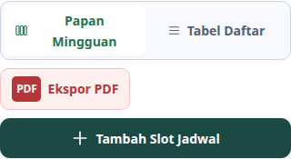
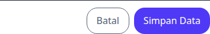
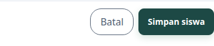

# Inspeksi tombol — 14 November 2026

## Kesimpulan

Tombol belum memiliki satu sistem visual yang diterapkan konsisten. Masalah utama terdapat pada ikon ekspor yang terhimpit, aksi jadwal mobile yang kecil, tab dengan tinggi berbeda, dan tombol dialog yang berbeda bentuk, warna, serta ketebalan untuk fungsi yang sama.

Inspeksi ini menghasilkan laporan dan bukti; belum mengubah komponen atau CSS aplikasi.

## Cakupan

- Seluruh 76 halaman Vue serta komponen/stylesheet terkait dipindai.
- Ditemukan 650 deklarasi kontrol pada template: 527 elemen button dan 123 tautan yang memakai kelas menyerupai tombol. Tersebar pada 73 file dengan 195 string kelas statis berbeda. Ini jumlah deklarasi source, bukan jumlah tombol unik yang tampil atau jumlah varian desain.
- Render build aplikasi diperiksa pada 19 halaman/peran, lebar 390/1440 CSS px, serta preferensi tema terang/gelap: 76 skenario. Halaman publik dan login tetap memaksa tema terang.
- Formulir tambah siswa, guru, jadwal, pengguna, dan soal dibuka pada masing-masing kombinasi ukuran/tema: 20 pengamatan dialog/formulir tambahan.
- Menggunakan fixture seed demo dari inspeksi sebelumnya; data produksi tidak dipakai. Semua permintaan non-GET diblokir. Tidak ada formulir disubmit atau data disimpan.
- Tidak ada error JavaScript pada sampel. State hover dan fokus programatis sebagian tombol utama dicatat; ini belum merupakan pengujian keyboard lengkap, loading, atau error seluruh formulir.

## Temuan prioritas

### P1 — Ikon ekspor siswa terhimpit di mobile

Header siswa membatasi tombol ekspor menjadi 44×44 px. Tombol tersebut sekaligus merender SVG dan badge `::before` dari `.file-action-button` yang memiliki lebar minimum 32 px. Bersama padding/gap, ruang tidak cukup: lebar SVG terukur hanya **2,8125 px**, sementara tingginya 19 px.

Ini masalah layout yang terkonfirmasi, bukan variasi ikon yang disengaja. Pilih satu ikon SVG atau badge file per tombol. Untuk icon-only, elemen ikon harus tidak menyusut; label aksi tetap tersedia lewat nama aksesibel.

Sumber: `resources/css/app.css:252` dan `resources/js/Pages/Academic/Students/Index.vue:757`.

### P1 — Aksi jadwal mobile masih 28×28 px

| Aksi setara di mobile | Ukuran render |
|---|---:|
| Edit/Hapus siswa | 44×44 px |
| Ubah/Hapus guru | 44×44 px |
| Ubah/Hapus slot jadwal | 28×28 px |
| Tambah jadwal pada header hari | 28×28 px |

`.schedule-session :deep(.row-action-button)` menimpa ukuran bersama 44 px menjadi 28 px. Pada tabel jadwal ada override lain menjadi 32 px. Ikon jadwal juga diperkecil menjadi 13 px, sedangkan aksi siswa/guru mobile memakai 19 px.

Sumber: `resources/js/Pages/Academic/Schedules/Index.vue:978`, `resources/js/Pages/Academic/Schedules/Index.vue:992`, dan `resources/css/app.css:202`.

Target 28 px tidak otomatis melanggar batas minimum AA 24 px; namun jauh dari standar sentuh 44 px yang sudah dipakai halaman lain. Ini prioritas konsistensi dan kenyamanan penggunaan.

### P1 — Tab jadwal dalam kelompok yang sama tidak sama tinggi

Pada lebar 390 px, “Papan Mingguan” terukur **57,38 px**, sedangkan “Tabel Daftar” **36 px**. Label pertama membungkus dua baris dan kedua tombol tidak mengikuti tinggi kelompok yang sama.

Gunakan label ringkas yang konsisten, tinggi minimum bersama, serta alignment stretch pada kelompok. Jangan memaksa tinggi tetap yang memotong label.

### P2 — Tombol simpan dan batal antar-dialog berbeda

Contoh hasil render mobile:

| Formulir | Tombol simpan | Weight | Radius |
|---|---|---:|---:|
| Siswa | Hijau/warna sekolah | 700 | 9 px |
| Guru | Ungu hardcoded | 400 | 18 px |
| Jadwal | Ungu hardcoded | 400 | 18 px |
| Pengguna | Hijau/warna sekolah | 700 | 9 px |
| Bank soal | Hijau/warna sekolah | 700 | 9 px |

Tombol Batal pada siswa/guru/jadwal memakai weight 400 dan radius 18 px; Batal pada pengguna/bank soal memakai weight 700 dan radius 9 px. Tinggi sekitar 44 px saja belum membuat tampilannya konsisten.

Source juga memuat 26 tombol formulir dengan pola utility `px-4 py-2 text-sm ...` yang berdiri sendiri, pada enam file: kelas, siswa, guru, jadwal, catatan perwalian, serta kedisiplinan.

### P2 — Token umum bertabrakan dengan utility

Dua penyebab terverifikasi dari source dan CSS build:

1. `.rounded-lg` hasil build memakai `var(--radius-lg)`. Token proyek `--radius-lg` bernilai 18 px. Karena itu utility yang dipakai pada tombol formulir menghasilkan radius jauh lebih besar dari tombol bersama 9–10 px.
2. `button, input, select, textarea { font: inherit; }` di `shell.css` tidak ber-layer. Deklarasi ini dapat mengalahkan utility dalam layer Tailwind, termasuk `font-semibold`. Pada tombol Simpan Data dan Simpan Jadwal, computed weight memang 400 walaupun template menyebut `font-semibold`.

Sumber: `resources/css/shell.css:151` serta token radius pada file yang sama. Deklarasi `.rounded-lg` dan `.font-semibold` telah diverifikasi pada build CSS.

Perbaikan sebaiknya menggunakan token khusus tombol dan satu komponen, disertai penataan prioritas CSS. Menambahkan override baru per halaman akan mempertahankan akar masalah.

### P2 — Banyak ukuran untuk peran tombol yang sama

Contoh render pada mobile:

| Tombol | Tinggi |
|---|---:|
| Tambah siswa | 44 px, icon-only |
| Tambah guru | 45,88 px, full-width |
| Tambah slot jadwal | 44,28 px, full-width |
| Ekspor PDF jadwal | 46 px |
| Buka tugas | 34,63 px |
| Terapkan filter bank soal | 42 px |
| Duplikasi soal | 35,88 px |
| Tutup dialog jadwal/bank soal | 40 px |

Perbedaan subpixel kecil bukan prioritas. Yang perlu diputuskan adalah kategori ukuran dan perilaku responsifnya: aksi utama, aksi baris, icon-only, tab, dan kontrol inline. Keputusan mobile untuk menampilkan label atau hanya ikon saat ini juga berbeda antarmodul.

### P2 — Ikon dan hierarki aksi belum seragam

- Tambah siswa/guru memakai ikon plus SVG; Tambah soal memakai karakter `+`; Tambah pengguna tanpa ikon.
- Ekspor Excel guru memakai SVG saja; ekspor siswa memakai SVG sekaligus badge; ekspor jadwal memakai badge PDF.
- Aksi baris bank soal mencampurkan tombol Ubah/Arsipkan berbingkai dengan Duplikasi/Bagikan berbentuk text-button. Sebagian perbedaan bobot ini dapat disengaja, tetapi aturan prioritasnya belum dinyatakan.
- Ukuran ikon yang terukur mencakup 13, 14, 15, 16, 17, 18, 19, dan 20 px; kasus 2,8 px adalah cacat penyusutan, bukan ukuran yang patut dipertahankan.

Gunakan dua skala ikon yang disengaja, dan tetapkan pola ikon/label yang sama untuk aksi setara.

### P3 — State fokus dan disabled memiliki beberapa definisi

Source memuat ketebalan fokus 2/3 px, warna fokus berbasis token maupun RGBA biru hardcoded, dan opacity disabled .42/.48/.5/.55/.65. Sampel menunjukkan fokus siswa/guru berbeda dari pengguna/bank soal. Tidak semua variasi merupakan kegagalan aksesibilitas, tetapi pemeliharaannya sulit dan hasilnya tidak konsisten.

State hover, focus-visible, disabled, dan loading perlu menjadi bagian komponen tombol yang sama. Verifikasi keyboard dan indikator loading masih diperlukan setelah implementasi.

## Standar yang disarankan

Ini usulan desain untuk aplikasi, bukan klaim semua tombol harus identik.

| Kategori | Desktop | Mobile/sentuh | Ikon |
|---|---:|---:|---:|
| Aksi utama/sekunder | Min. tinggi 40 px | Min. tinggi 44 px | 18 px |
| Aksi baris ringkas | Min. tinggi 32 px | Min. area 44×44 px | 16–18 px |
| Icon-only | 40×40 px | 44×44 px | 18 px |
| CTA besar/login | Min. tinggi 48 px | Min. tinggi 48 px | 18–20 px |
| Tab/filter pill | Kategori tersendiri | Min. tinggi 44 px | 16–18 px |

Aturan bersama:

- Radius tombol 10 px; pill hanya untuk kategori chip/filter yang memang memerlukannya.
- Font tombol 14 px, weight 600, line-height yang sama. Ikon tidak menyusut.
- Jarak ikon–label 8 px dan padding horizontal 12–16 px.
- Tinggi boleh bertambah untuk label dua baris; tombol dalam satu kelompok mengikuti tinggi yang sama.
- Lebar tombol berlabel mengikuti isi. Full-width digunakan konsisten pada konteks mobile tertentu, bukan efek samping grid.
- Primary memakai warna aksi sekolah; secondary netral; destructive merah; ghost untuk aksi ringan. Ekspor memakai secondary dengan satu ikon file.
- Nama aksesibel tetap wajib saat label disembunyikan. Sampel yang dipindai memiliki nama dari teks, aria-label, atau title; pemeriksaan screen reader lengkap belum dilakukan.

## Urutan perbaikan

1. Hentikan ikon ekspor yang menyusut dan besarkan area sentuh jadwal.
2. Buat satu komponen tombol dengan varian primary, secondary, danger, ghost, serta icon-only; sediakan ukuran yang eksplisit.
3. Migrasikan tombol simpan/batal seluruh dialog dan hentikan kelas utility mandiri yang bertentangan.
4. Samakan header tindakan, ekspor, serta tab jadwal; kemudian rapikan aksi baris semua modul.
5. Uji desktop/mobile, label panjang, tema gelap, fokus keyboard, disabled, loading, dan pembesaran teks.

## Bukti dan batas

- `source-inventory.json`: lokasi kontrol dan aturan CSS yang relevan.
- `runtime-results.json`: ukuran, padding, radius, warna, font, SVG, pseudo-element, nama kontrol, dan state sampel.
- `evidence-results.json` dan screenshot: potongan header/footer siswa, guru, dan jadwal.
- 76 skenario awal + 20 pengamatan dialog; tidak mencakup seluruh state 76 halaman atau semua konfigurasi branding.
- Angka dimensi adalah computed bounding box pada fixture. Kontrol di luar viewport horizontal dan elemen tersembunyi dilewati. Tombol latar yang masih ada di DOM saat dialog terbuka dapat ikut terekam; temuan dialog memilih tombol formulir yang relevan.

## Acuan ukuran sentuh

[WCAG 2.2 SC 2.5.8](https://www.w3.org/WAI/WCAG22/Understanding/target-size-minimum.html) menetapkan batas AA 24×24 CSS px dengan pengecualian. [SC 2.5.5](https://www.w3.org/WAI/WCAG22/Understanding/target-size-enhanced.html) memakai 44×44 CSS px pada tingkat AAA. Rekomendasi 44 px mobile di laporan ini adalah pilihan kenyamanan dan konsistensi produk; ukuran di bawahnya tidak otomatis berarti gagal AA.
