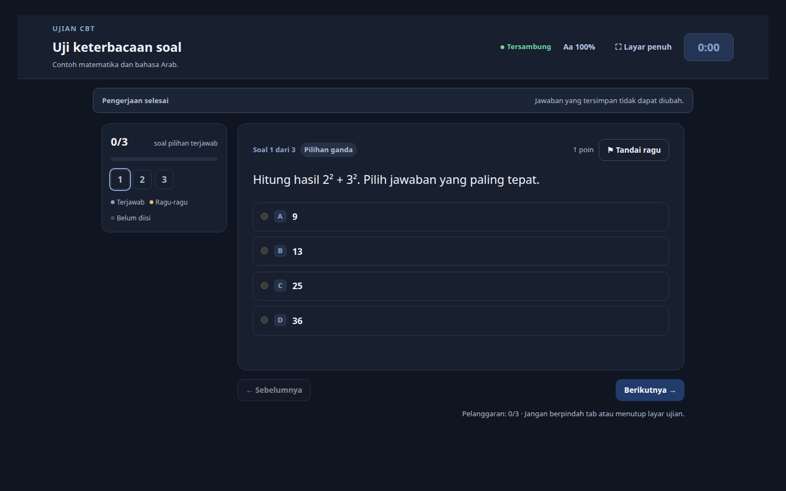
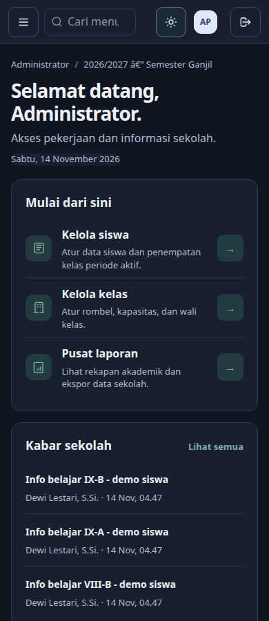

# Audit dan perbaikan dark mode

14 November 2026

## Perubahan

- Pengaturan tema disatukan di `resources/js/composables/useTheme.ts`. Preferensi pengguna tersimpan, mengikuti sistem jika belum ada pilihan, dan tersinkron antartab. Storage yang diblokir tidak menghentikan aplikasi.
- Tema awal diterapkan sebelum stylesheet dan aplikasi dimuat. Pemilihan tema halaman menggunakan nama komponen Inertia sehingga tidak menunggu pencarian DOM setelah render.
- Perpindahan manual memakai crossfade snapshot 180 ms. Browser tanpa View Transitions memakai transisi warna sementara. Reduced motion mematikan animasi perpindahan. Klik berulang membatalkan transisi sebelumnya tanpa unhandled rejection.
- Tombol tema tersedia pada mobile, memiliki ikon matahari/bulan dan `aria-pressed`. Di layar kecil, ruang header diprioritaskan untuk pencarian dan tombol tema.
- Warna teks soal, opsi, nomor soal, timer, status, dan peringatan ujian memakai token tema. Monitor ujian, hasil, dan paket soal juga memakai token warna teks, permukaan, border, dan status.
- Indikator peringatan guru/kapasitas kelas, catatan tindak lanjut persuratan, badge progres belajar, serta status penerimaan/daftar ulang siswa memakai pasangan warna tema.
- Toast error memakai warna semantik tema.

## Bukti dan batas pemeriksaan

- `before.json` / `after.json`: sampel awal 19 halaman/peran × 390/1440 px × light/dark, serta 20 pengamatan formulir. Audit awal mencatat 42 kejadian kontras teks rendah pada dark mode (termasuk pengulangan ukuran layar); hasil perbaikan sampel ini nol.
- `extended-before.json` / `extended-after.json`: tambahan persuratan, sarpras, tugas staf, progres belajar, penerimaan siswa, kelas, dan pengelolaan ujian. Baseline tambahan mencatat 303 kejadian kontras rendah, termasuk teks yang berulang pada tabel. Pemeriksaan akhir mencakup 27 halaman/peran × dua ukuran × kedua mode (108 pengamatan), termasuk paket soal dan dialognya. Akses paket soal memakai peran guru; permintaan admin yang ditolak 403 dikecualikan.
- Hasil akhir: nol kegagalan kontras teks dark mode pada seluruh sampel dan formulir yang diperiksa; light mode juga lulus setelah mengecualikan pagination nonaktif. Tidak ada error JavaScript pada pemeriksaan akhir.
- Cakupan gabungan: 36 halaman/peran. Pemeriksaan render awal dan tambahan berjumlah 184 pengamatan dengan sebagian halaman diperiksa ulang.
- `transitions.json`: 11 skenario berhasil—320/390/1440 px × snapshot/reduced motion/fallback, serta preferensi sistem dan storage diblokir. Memeriksa reload, klik berulang, sinkronisasi antartab, nama/status tombol, overflow kontrol header, dan kunjungan halaman publik/login lalu kembali.
- TypeScript dan build produksi lulus. Dua kelompok tes PHP terkait lulus: 29 tes/213 assertion dan 45 tes/476 assertion. `git diff --check` bersih.

Data berasal dari seed demo dan fixture SQLite sementara, bukan data produksi. Permintaan mutasi browser diblokir. Pemeriksaan kontras menghitung warna teks terhadap komposit background CSS, dengan ambang 4,5:1 untuk teks biasa dan 3:1 untuk teks besar; ini bukan sertifikasi WCAG. Gambar latar, pseudo-element, seluruh variasi data, dan semua state interaktif tidak tercakup otomatis. Permukaan status dan teks sekunder light mode juga diperjelas berdasarkan hasil pemeriksaan tambahan. Kontrol nonaktif dikecualikan; label pagination nonaktif pada sampel light mode tetap tercatat dalam JSON karena berupa span tanpa atribut disabled.

Halaman publik dan login mempertahankan desain terang yang sudah ada. Preferensi workspace tidak dihapus ketika halaman tersebut dibuka. Lembar rapor tetap berwarna putih sebagai pratinjau dokumen cetak; bukan kebocoran permukaan dark mode.

## Menjalankan ulang

Dari root proyek, setelah `npm run build`:

```sh
node artifacts/dark-mode/audit.mjs --after
node artifacts/dark-mode/audit.mjs --extended --after
node artifacts/dark-mode/transitions.mjs
node artifacts/dark-mode/verify-results.mjs
```

Script menggunakan Playwright, origin HTTPS yang diintersep lokal, dan build lokal. HTTPS diperlukan agar API secure context seperti `crypto.randomUUID()` pada paket soal tersedia. `collect.php` dapat memperbarui fixture tambahan hanya pada konfigurasi database SQLite `:memory:`; terdapat guard sebelum migrasi dijalankan. Audit awal juga membutuhkan fixture pada `artifacts/font-cleanup/page-fixtures.json`.

## Tangkapan layar




