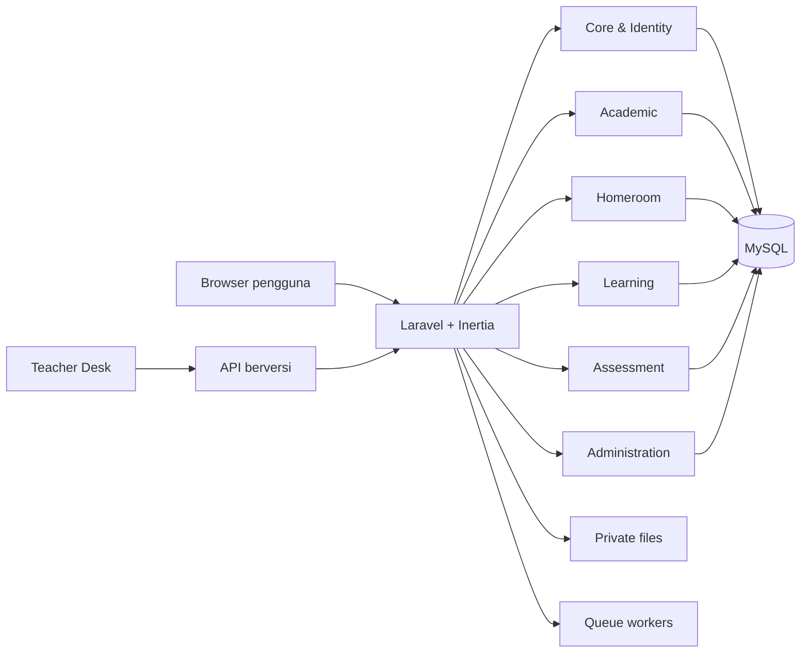

# Architecture — School Suite

## Keputusan awal

Gunakan modular monolith: Laravel, Inertia, Vue, TypeScript, MySQL, penyimpanan privat, dan worker antrean. Versi dependency dipilih saat bootstrap melalui uji kompatibilitas. Microservices hanya dipertimbangkan setelah pengukuran membuktikan kebutuhan.



## Batas modul

| Modul | Memiliki |
|---|---|
| Core | sekolah, user, role, permission, audit, pengaturan |
| Academic | periode, siswa, guru, kelas, enrollment, mapel, penugasan, jadwal |
| Homeroom | catatan perkembangan, kejadian, tindak lanjut, pertemuan wali |
| Learning | materi, tugas, submission, feedback |
| Assessment | skema, rubrik, nilai, remedial, rapor, soal dan ujian |
| Admissions | calon siswa, berkas, seleksi, daftar ulang |
| Library | katalog, eksemplar, sirkulasi |
| Administration | surat, arsip, sarpras, pengumuman |
| Integration | koneksi perangkat, inbox, pemetaan ID, idempotensi |

Modul tidak menulis tabel milik modul lain secara langsung. Interaksi lintas modul melalui application service/event yang memiliki kontrak dan tes.

## Lapisan

`Domain` berisi aturan murni; `Application` mengorkestrasi use case dan transaksi; `Infrastructure` menangani database/file/queue; `Interface` menangani HTTP/Inertia/API. Controller tipis dan tidak memuat formula nilai.

## Keamanan dan operasi

- Default deny untuk policy; scope sekolah dan periode wajib eksplisit.
- Validasi MIME, ukuran, nama, dan izin untuk lampiran.
- Backup terenkripsi di lokasi operasi; restore drill sebelum rilis.
- Structured logs tanpa nilai sensitif; health check untuk DB, storage, dan queue.
- Migrasi database harus forward-safe dan memiliki rencana pemulihan.

## Struktur target

```text
app/Modules/{Core,Academic,Homeroom,Learning,Assessment,Admissions,Library,Administration,Integration}
app/Shared/{Audit,Files,Exports,Notifications}
resources/js/{layouts,components,modules}
tests/{Unit,Feature,Contracts}
docs/adr
```

