# ERD — School Suite

Diagram ini adalah model konseptual pilot; nama kolom final dikunci melalui migrasi dan ADR bila berubah material.

```mermaid
erDiagram
  SCHOOLS ||--o{ USERS : scopes
  SCHOOLS ||--o{ ACADEMIC_YEARS : owns
  ACADEMIC_YEARS ||--o{ TERMS : contains
  STUDENTS ||--o{ ENROLLMENTS : has
  CLASS_GROUPS ||--o{ ENROLLMENTS : contains
  TERMS ||--o{ ENROLLMENTS : scopes
  TEACHERS ||--o{ TEACHING_ASSIGNMENTS : receives
  SUBJECTS ||--o{ TEACHING_ASSIGNMENTS : assigns
  CLASS_GROUPS ||--o{ TEACHING_ASSIGNMENTS : schedules
  TEACHING_ASSIGNMENTS ||--o{ LESSON_SESSIONS : creates
  LESSON_SESSIONS ||--o{ ATTENDANCE_RECORDS : records
  ENROLLMENTS ||--o{ ATTENDANCE_RECORDS : belongs
  ASSESSMENT_SCHEMES ||--o{ ASSESSMENT_COMPONENTS : defines
  ASSESSMENT_COMPONENTS ||--o{ SCORES : receives
  SUBJECTS ||--o{ EXAM_QUESTIONS : classifies
  SCHOOLS ||--o{ QUESTION_CATEGORIES : owns
  SCHOOLS ||--o{ QUESTION_TAGS : owns
  QUESTION_CATEGORIES ||--o{ QUESTION_CATEGORY_LINKS : groups
  EXAM_QUESTIONS ||--o{ QUESTION_CATEGORY_LINKS : classified
  QUESTION_TAGS ||--o{ QUESTION_TAG_LINKS : labels
  EXAM_QUESTIONS ||--o{ QUESTION_TAG_LINKS : tagged
  QUESTION_KKO_TERMS }o--o| SUBJECTS : specializes
  QUESTION_KKO_TERMS ||--o{ EXAM_QUESTIONS : classifies
  SCHOOLS ||--o{ QUESTION_PACKS : owns
  USERS ||--o{ QUESTION_PACKS : creates
  QUESTION_PACKS ||--o{ QUESTION_PACK_ITEMS : orders
  EXAM_QUESTIONS ||--o{ QUESTION_PACK_ITEMS : references
  EXAM_QUESTION_VERSIONS ||--o{ QUESTION_PACK_ITEMS : snapshots
  SCHOOLS ||--o{ QUESTION_SHARES : scopes
  USERS ||--o{ QUESTION_SHARES : sends
  USERS ||--o{ QUESTION_SHARES : receives
  QUESTION_SHARES ||--o{ QUESTION_SHARE_EVENTS : records
  USERS ||--o{ QUESTION_SHARE_EVENTS : acts
  EXAM_QUESTIONS ||--o{ EXAM_QUESTION_VERSIONS : versions
  EXAM_QUESTION_VERSIONS ||--o{ QUESTION_VERSION_CATEGORY_LINKS : snapshots
  EXAM_QUESTION_VERSIONS ||--o{ QUESTION_VERSION_TAG_LINKS : snapshots
  EXAM_QUESTION_VERSIONS ||--o{ EXAM_QUESTION_ITEMS : snapshots
  EXAMS ||--o{ EXAM_QUESTION_ITEMS : contains
  EXAM_QUESTION_VERSIONS ||--o{ EXAM_ANSWERS : answers
  ENROLLMENTS ||--o{ SCORES : owns
  ENROLLMENTS ||--o{ STUDENT_OBSERVATIONS : has
  ENROLLMENTS ||--o{ REPORT_SNAPSHOTS : publishes
  USERS ||--o{ AUDIT_EVENTS : acts
```

## Aturan data penting

- `students` adalah identitas orang; kelas saat ini ditentukan oleh `enrollments`, bukan kolom pada siswa.
- Semua data akademik memiliki referensi periode yang tidak berubah diam-diam.
- NIS/NISN adalah atribut pencocokan, bukan satu-satunya identitas internal.
- Nilai menyimpan komponen dan versi skema; rapor terbit menyimpan snapshot immutable.
- Butir bank soal adalah identitas stabil; perubahan isi membuat versi baru dan tidak menulis ulang versi yang telah dipakai ujian.
- Item ujian menunjuk versi butir yang digunakan. Metadata mapel, jenjang, kurikulum, indikator, level kognitif, dan KKO ikut disalin pada versi untuk mempertahankan konteks historis.
- Kategori dan tag dimiliki sekolah; relasi pada identitas soal mendukung katalog, sedangkan relasi pada versi menjaga klasifikasi historis. Master KKO dapat berlaku umum atau khusus mapel/sekolah; teks dan level juga disalin ke versi.
- Level operasional L1/L2/L3 dipetakan ke Bloom revisi secara praktis: L1 ≈ C1–C2 (LOTS), L2 ≈ C3–C4 (MOTS), L3 ≈ C5–C6 (HOTS). Pemetaan ini panduan klasifikasi, bukan kesetaraan akademik mutlak.
- Berbagi soal/paket tetap berada dalam `school_id`; izin tunggal `view`/`copy`/`edit` aktif setelah persetujuan dan dapat dicabut. Perubahan status dicatat append-only pada `question_share_events`; penerima hasil salin menjadi pemilik salinan, bukan sumber.
- Absensi harian dan absensi pertemuan berbeda walaupun dapat direkap bersama.
- Catatan BK/privat memakai klasifikasi akses terpisah.
- Penghapusan data penting memakai status/arsip bila histori dibutuhkan; bukan cascade tanpa kajian.

## Entitas integrasi lanjutan

`device_connections`, `id_mappings`, `submission_inbox`, `idempotency_records`, `attachment_transfers`, dan `sync_audit_events`. Pemetaan tetap terkait instalasi sekolah dan pemilik, bukan hanya token/koneksi yang dapat berubah.

