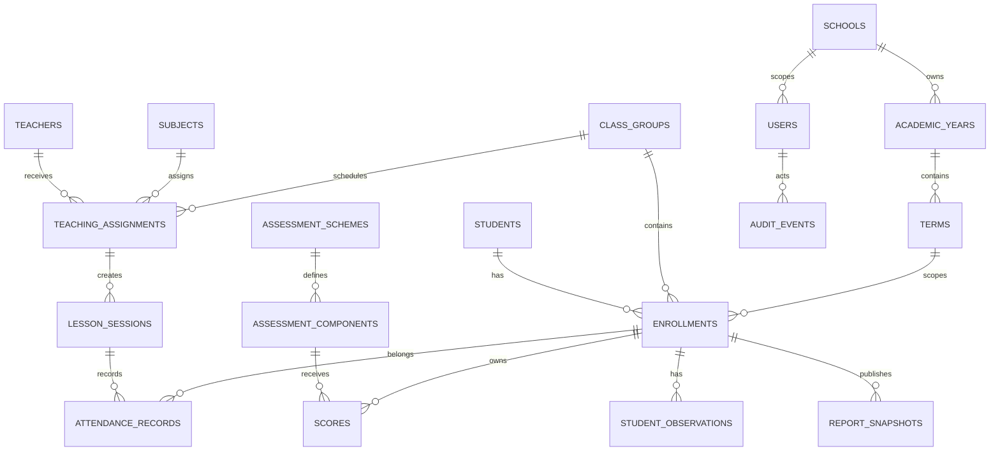

# ERD — School Suite

Diagram ini adalah model konseptual pilot; nama kolom final dikunci melalui migrasi dan ADR bila berubah material.

## Aturan data penting

- `students` adalah identitas orang; kelas saat ini ditentukan oleh `enrollments`, bukan kolom pada siswa.
- Semua data akademik memiliki referensi periode yang tidak berubah diam-diam.
- NIS/NISN adalah atribut pencocokan, bukan satu-satunya identitas internal.
- Nilai menyimpan komponen dan versi skema; rapor terbit menyimpan snapshot immutable.
- Absensi harian dan absensi pertemuan berbeda walaupun dapat direkap bersama.
- Catatan BK/privat memakai klasifikasi akses terpisah.
- Penghapusan data penting memakai status/arsip bila histori dibutuhkan; bukan cascade tanpa kajian.

## Entitas integrasi lanjutan

`device_connections`, `id_mappings`, `submission_inbox`, `idempotency_records`, `attachment_transfers`, dan `sync_audit_events`. Pemetaan tetap terkait instalasi sekolah dan pemilik, bukan hanya token/koneksi yang dapat berubah.

