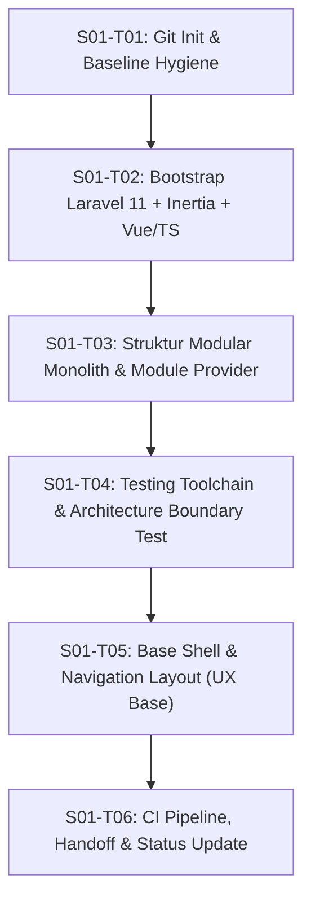

# TODO & Workflow Eksekusi: Tahap S01 (Fondasi)

> **Gate Keluar Tahap S01:** Instalasi bersih, modular monolith terstruktur, build frontend sukses, dan pipeline CI hijau (`tests/`, `pint`, `audit-docs`).

---

## Daftar Task & Acceptance Criteria

### [x] S01-T01: Inisialisasi Git & Hygiene Baseline
- [x] Inisialisasi git repository (`git init`) dengan branch `main`.
- [x] Siapkan `.gitignore` standar Laravel + Node + Environment + Storage privat.
- [x] Buat commit baseline awal untuk dokumentasi yang telah dirapikan ke `docs/`.
- **Bukti penerimaan:** `git status` bersih, commit baseline `f847ec4` tersimpan, audit dokumentasi lulus tanpa error.

---

### [x] S01-T02: Bootstrap Laravel 13 + Inertia.js + Vue 3 + TypeScript
- [x] Bootstrap kerangka Laravel (v13.38.0) yang kompatibel penuh dengan PHP 8.5.
- [x] Konfigurasi Inertia.js v3, Vue 3, Vite v8, Tailwind CSS v4, dan TypeScript (`tsconfig.json`).
- [x] Setup `HandleInertiaRequests` middleware dan root template `app.blade.php`.
- [x] Konfigurasi testing Inertia dan route endpoint `/` ter-render via Inertia `Welcome.vue`.
- [x] Konfigurasi `.env.example` dan database default SQLite dev/test.
- **Bukti penerimaan:** `php artisan --version` sukses, `npm run build` sukses (310ms), `npm run typecheck` sukses, `php artisan test` (2 tests, 9 assertions) lulus 100%, `pint --test` passed.

---

### [x] S01-T03: Struktur Direktori Modular Monolith & Shared Services
- [x] Buat kerangka direktori 9 modul di `app/Modules/`:
  - `Core`
  - `Academic`
  - `Homeroom`
  - `Learning`
  - `Assessment`
  - `Admissions`
  - `Library`
  - `Administration`
  - `Integration`
  Setiap modul memiliki subdirektori berlapis: `Domain/`, `Application/`, `Infrastructure/Database/Migrations/`, `Interface/Http/Controllers/`, `Interface/Routes/`.
- [x] Buat struktur shared services di `app/Shared/`:
  - `Audit`
  - `Files`
  - `Exports`
  - `Notifications`
  - `Providers/ModularServiceProvider.php`
- [x] Buat struktur frontend modul di `resources/js/modules/` dan direktori pendukung `layouts/`, `components/`.
- [x] Implementasikan `ModularServiceProvider` untuk auto-discovery migrations, web routes, dan api routes per modul.
- [x] Daftarkan `ModularServiceProvider` di `bootstrap/providers.php`.
- [x] Unit test `tests/Unit/ModularServiceProviderTest.php` untuk memvalidasi keberadaan modul & shared services.
- **Bukti penerimaan:** `php artisan test` (4 tests, 32 assertions) lulus 100%, seluruh direktori modul terdaftar dan teruji.

---

### [ ] S01-T04: Testing Toolchain & Invariant Boundary Protection
- [ ] Konfigurasi Pest PHP / PHPUnit untuk testing (`tests/Unit`, `tests/Feature`, `tests/Contracts`, `tests/Architecture`).
- [ ] Terapkan **Architecture Test** yang secara mekanik memvalidasi aturan monolit modular:
  - Modul dilarang mengakses tabel/model internal milik modul lain secara langsung.
  - Akses lintas modul hanya melalui application service / domain events / shared contracts.
- [ ] Tambahkan skrip CI lokal (`composer test`, `composer pint`, `npm run lint`).
- **Bukti penerimaan:** `composer test` berjalan hijau 100% dengan minimal 1 feature smoke test dan 1 architecture rule test.

---

### [ ] S01-T05: Base Application Shell & Navigation Layout (Inertia + Vue)
- [ ] Bangun layout utama aplikasi sesuai panduan [`docs/DESIGN.md`](DESIGN.md):
  - Area kerja peran: Beranda, Akademik, Pembelajaran, Wali Kelas, Administrasi, Laporan, Pengaturan.
  - Komponen persisten indikator periode aktif (tahun ajaran & semester) yang selalu terlihat.
  - Dukungan navigasi keyboard dan kontras aksesibilitas.
- [ ] Halaman dashboard placeholder yang ter-render via Inertia.
- **Bukti penerimaan:** Akses browser/HTTP endpoint `/` menampilkan shell aplikasi dengan Inertia, `npm run build` lulus tanpa type error.

---

### [ ] S01-T06: Verifikasi Gate S01 & Dokumentasi Handoff
- [ ] Jalankan audit tata kelola dokumentasi: `python3 ~/.gemini/config/skills/docs-governance/scripts/audit-docs.py --root . --scope full`.
- [ ] Perbarui [`docs/HANDOFF.md`](HANDOFF.md) dengan rincian file baru, arsitektur, hasil tes, dan langkah review.
- [ ] Perbarui status fase di [`docs/PROJECT_STATUS.md`](PROJECT_STATUS.md).
- **Bukti penerimaan:** Semua gate keluar S01 terpenuhi tanpa kegagalan tes.

