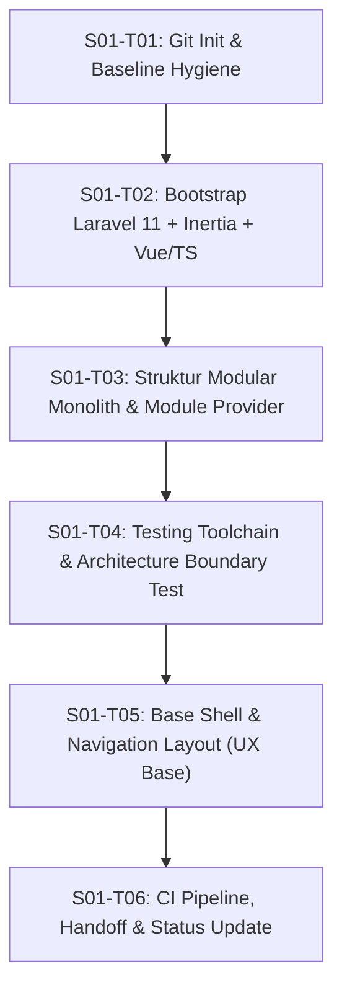

# TODO & Workflow Eksekusi: Tahap S01 (Fondasi)

> **Gate Keluar Tahap S01:** Instalasi bersih, modular monolith terstruktur, build frontend sukses, dan pipeline CI hijau (`tests/`, `pint`, `audit-docs`).

---

## Daftar Task & Acceptance Criteria

### [x] S01-T01: Inisialisasi Git & Hygiene Baseline
- [x] Inisialisasi git repository (`git init`) dengan branch `main`.
- [x] Siapkan `.gitignore` standar Laravel + Node + Environment + Storage privat.
- [x] Buat commit baseline awal untuk dokumentasi yang telah dirapikan ke `docs/`.
- **Bukti penerimaan:** `git status` bersih, commit baseline `f847ec4` tersimpan, audit dokumentasi lulus tanpa error.

---

### [x] S01-T02: Bootstrap Laravel 13 + Inertia.js + Vue 3 + TypeScript
- [x] Bootstrap kerangka Laravel (v13.38.0) yang kompatibel penuh dengan PHP 8.5.
- [x] Konfigurasi Inertia.js v3, Vue 3, Vite v8, Tailwind CSS v4, dan TypeScript (`tsconfig.json`).
- [x] Setup `HandleInertiaRequests` middleware dan root template `app.blade.php`.
- [x] Konfigurasi testing Inertia dan route endpoint `/` ter-render via Inertia `Welcome.vue`.
- [x] Konfigurasi `.env.example` dan database default SQLite dev/test.
- **Bukti penerimaan:** `php artisan --version` sukses, `npm run build` sukses (310ms), `npm run typecheck` sukses, `php artisan test` (2 tests, 9 assertions) lulus 100%, `pint --test` passed.

---

### [x] S01-T03: Struktur Direktori Modular Monolith & Shared Services
- [x] Buat kerangka direktori 9 modul di `app/Modules/`:
  - `Core`
  - `Academic`
  - `Homeroom`
  - `Learning`
  - `Assessment`
  - `Admissions`
  - `Library`
  - `Administration`
  - `Integration`
  Setiap modul memiliki subdirektori berlapis: `Domain/`, `Application/`, `Infrastructure/Database/Migrations/`, `Interface/Http/Controllers/`, `Interface/Routes/`.
- [x] Buat struktur shared services di `app/Shared/`:
  - `Audit`
  - `Files`
  - `Exports`
  - `Notifications`
  - `Providers/ModularServiceProvider.php`
- [x] Buat struktur frontend modul di `resources/js/modules/` dan direktori pendukung `layouts/`, `components/`.
- [x] Implementasikan `ModularServiceProvider` untuk auto-discovery migrations, web routes, dan api routes per modul.
- [x] Daftarkan `ModularServiceProvider` di `bootstrap/providers.php`.
- [x] Unit test `tests/Unit/ModularServiceProviderTest.php` untuk memvalidasi keberadaan modul & shared services.
- **Bukti penerimaan:** `php artisan test` (4 tests, 32 assertions) lulus 100%, seluruh direktori modul terdaftar dan teruji.

---

### [x] S01-T04: Testing Toolchain & Invariant Boundary Protection
- [x] Konfigurasi PHPUnit 12 runner di `phpunit.xml` dengan testsuite: `Unit`, `Feature`, `Architecture`, dan `Contracts`.
- [x] Implementasikan AST-based **Architecture Test** di `tests/Architecture/ModularBoundaryTest.php`:
  - `test_modules_cannot_import_other_modules_infrastructure_or_models`: Mengunci larangan coupling langsung ke tabel/model/infrastructure modul lain.
  - `test_domain_layer_must_not_import_http_artifacts`: Menjaga kemurnian lapisan domain dari artefak HTTP/Inertia.
  - `test_controllers_must_reside_in_interface_layer`: Menjaga controller tetap tipis dan berada di lapisan Interface.
  - `test_boundary_checker_detects_illegal_cross_module_import`: Verifikasi akurasi pendeteksian pelanggaran batas modular.
- [x] Tambahkan skrip composer terpadu di `composer.json`: `composer test`, `composer lint`, `composer format`.
- **Bukti penerimaan:** `composer test` (8 tests, 38 assertions) lulus 100%, `composer lint` passed, seluruh aturan arsitektural monolit modular terlindungi secara otomatis.

---

### [x] S01-T05: Base Application Shell & Navigation Layout (Inertia + Vue)
- [x] Bangun layout utama aplikasi sesuai panduan [`docs/DESIGN.md`](DESIGN.md):
  - Area kerja navigasi: Beranda, Akademik, Pembelajaran, Wali Kelas, Administrasi, Laporan, Pengaturan di `resources/js/components/SidebarNavigation.vue`.
  - Komponen persisten indikator periode aktif (`resources/js/components/ActivePeriodBadge.vue`) dan identitas unit sekolah di `resources/js/components/TopNavbar.vue`.
  - Aksesibilitas: Skip link navigasi keyboard (`Lewati ke konten utama`), fokus visual kontras (`focus-visible:ring-2`), semantic HTML.
  - Shell terpadu di `resources/js/layouts/AppLayout.vue`.
- [x] Halaman dashboard utama di `resources/js/Pages/Dashboard.vue` ter-render via Inertia dari route `/`.
- [x] Berbagi data global (nama sekolah, periode aktif, flash message) via `HandleInertiaRequests.php`.
- **Bukti penerimaan:** Feature test `ExampleTest` memvalidasi komponen `Dashboard`, `stats.modules_ready = 9`, dan `activePeriod.label` (8 tests, 42 assertions passed); `npm run build` & `npm run typecheck` sukses 100%.

---

### [x] S01-T06: Verifikasi Gate S01 & Dokumentasi Handoff
- [x] Eksekusi seluruh suite pengujian CI (`composer test`: 8 passed, 42 assertions).
- [x] Validasi gaya kode (`composer lint`: passed).
- [x] Validasi typecheck frontend (`npm run typecheck`: passed) dan bundle build (`npm run build`: passed).
- [x] Jalankan audit tata kelola dokumentasi: `python3 ~/.gemini/config/skills/docs-governance/scripts/audit-docs.py --root . --scope full` (exit code 0).
- [x] Perbarui [`docs/HANDOFF.md`](HANDOFF.md) dengan rincian final S01, arsitektur, bukti verifikasi, dan rollback plan.
- [x] Perbarui status fase di [`docs/PROJECT_STATUS.md`](PROJECT_STATUS.md) (Tahap S01 selesai, siap lanjut S02).
- **Bukti penerimaan:** Seluruh kriteria gate keluar Tahap S01 terpenuhi 100%. Repositori berada dalam kondisi bersih dan hijau.

