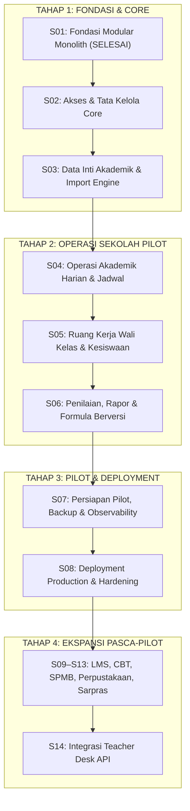

# Master Plan & Workflow Eksekusi: School Suite (End-to-End sampai Deploy)

> **Dokumen ini adalah rencana kerja komprehensif** yang memetakan seluruh siklus pengembangan School Suite mulai dari Fondasi (S01), Operasi Akademik & Penilaian Pilot (S02–S07), Deployment Production & Hardening (S08), hingga Ekspansi Modul Pasca-Pilot (S09–S14).

---

## Ringkasan Roadmap & Gate Keluar

| Tahap | Fokus Utama | Target Gate Keluar | Status |
|---|---|---|---|
| **S01** | Fondasi Modular Monolith & Toolchain | Instalasi bersih, modular monolith terstruktur, CI hijau | **SELESAI (Commit `831b7e8`)** |
| **S02** | Akses & Tata Kelola Core | Matriks akses lulus server-side, audit trail aktif | **BERIKUTNYA** |
| **S03** | Data Inti Akademik & Import Engine | Histori enrollment teruji, validasi import lulus | Menunggu S02 |
| **S04** | Operasi Akademik Harian | Deteksi benturan jadwal & koreksi absensi teruji | Menunggu S03 |
| **S05** | Ruang Kerja Wali Kelas & Kesiswaan | Batas data privat lulus, rekap kelas teruji | Menunggu S04 |
| **S06** | Penilaian, Rapor & Formula Berversi | Contoh hitung manual cocok, snapshot rapor teruji | Menunggu S05 |
| **S07** | Persiapan Pilot & Observability | Drill restore terpisah sukses, SOP siap | Menunggu S06 |
| **S08** | Deployment Production & Hardening | Server production live, SSL/TLS, auto backup aktif | Menunggu S07 |
| **S09–S13** | Ekspansi Modul (LMS, CBT, SPMB, Sipus) | Gate kelulusan per modul mandiri | Pasca-Pilot |
| **S14** | Integrasi Teacher Desk | Idempotensi, sinkronisasi API teruji | Pasca-Stabil |

---

## Rincian Task & Acceptance Criteria

---

### [x] TAHAP S01: Fondasi Modular Monolith & Toolchain (SELESAI)

- [x] **S01-T01: Inisialisasi Git & Hygiene Baseline**
  - Inisialisasi repo git (`main`), `.gitignore` komprehensif, baseline dokumentasi di `docs/`.
  - *Bukti:* `git status` bersih, commit `f847ec4`.
- [x] **S01-T02: Bootstrap Laravel 13 + Inertia.js v3 + Vue 3 + TypeScript**
  - Framework Laravel 13 di PHP 8.5, Vite v8, Tailwind CSS v4, TypeScript (`tsconfig.json`).
  - *Bukti:* `php artisan test` passed, `npm run build` sukses (310ms), commit `9a1b855`.
- [x] **S01-T03: Struktur Direktori Modular Monolith & Shared Services**
  - 9 modul di `app/Modules/*` (4 lapis), 4 shared services di `app/Shared/*`, `ModularServiceProvider`.
  - *Bukti:* `ModularServiceProviderTest` passed (32 assertions), commit `5e21f8f`.
- [x] **S01-T04: Testing Toolchain & Architecture Boundary Test**
  - PHPUnit testsuites (`Unit`, `Feature`, `Architecture`, `Contracts`), AST Architecture Test.
  - *Bukti:* `ModularBoundaryTest` passed (mengunci larangan cross-module model coupling), commit `58638a1`.
- [x] **S01-T05: Base Application Shell & Navigation Layout (UX Base)**
  - Shell `AppLayout.vue`, `ActivePeriodBadge.vue` persisten, navigasi area kerja, accessibility skip link.
  - *Bukti:* Feature test dashboard passed, build frontend 409ms, commit `10cb176`.
- [x] **S01-T06: Verifikasi Gate S01 & Dokumentasi Handoff**
  - Seluruh CI hijau, audit dokumentasi 100%, handoff terdokumentasi.
  - *Bukti:* Commit `831b7e8`.

---

### [x] TAHAP S02: Akses & Tata Kelola Core (`app/Modules/Core`)

> **Kebutuhan Terkait:** `SS-F-001`, `AI_RULES.md` (aturan 6: default deny policy server-side), `ARCHITECTURE.md`.  
> **Gate Keluar:** Matriks otorisasi server-side lulus, seluruh aksi material tercatat dalam audit log.

- [x] **S02-T01: Migrasi Skema Basis Data Core**
  - Tabel: `schools` (profil sekolah tunggal `SS-D-001`), `roles`, `permissions`, `role_permissions`, penambahan kolom `users` (`school_id`, `role_id`, `username`, `phone`, `is_active`), dan `audit_events`.
  - Model Eloquent di `app/Modules/Core/Infrastructure/Models/` (`School`, `Role`, `Permission`, `AuditEvent`) dan ekstensi relasi serta helper permission di `app/Models/User.php`.
  - Migrasi forward-safe dengan rollback drop table yang bersih.
  - *Bukti:* `php artisan migrate:fresh` dan `php artisan migrate:rollback` sukses; Feature test `CoreMigrationTest` (10 tests, 68 assertions) lulus 100%.
- [x] **S02-T02: Domain & Application Service Core (Otorisasi Server-Side)**
  - Entitas domain `RoleEnum`, `PermissionEnum` di `app/Modules/Core/Domain/`.
  - Kebijakan otorisasi server-side (Default Deny): `UserPolicy` dan `SchoolPolicy` di `app/Modules/Core/Application/Policies/` didaftarkan via `CoreServiceProvider`.
  - Service aplikasi `UserService` di `app/Modules/Core/Application/Services/` dengan pengecekan Gate eksplisit dan isolasi data per sekolah.
  - Aturan keamanan teruji: penolakan tanpa izin (403), isolasi akses lintas sekolah, larangan penghapusan akun sendiri oleh admin.
  - *Bukti:* Feature test `CoreAuthorizationTest` (6 tests, 21 assertions) lulus 100%; total testsuite: 16 passed, 89 assertions.
- [x] **S02-T03: Engine Audit Log Terpusat (`app/Shared/Audit`)**
  - Implementasi `AuditLogger` di `app/Shared/Audit/AuditLogger.php` dengan penangkapan metadata terpusat (`actor_id`, `school_id`, `event_type`, `target_type`, `target_id`, `old_values`, `new_values`, `ip_address`, `user_agent`).
  - Mekanisme sanitasi otomatis rekursif untuk me-redact seluruh parameter sensitif (`password`, `token`, `secret`, `api_key`, dll.) menjadi `'[REDACTED]'`.
  - Integrasi dengan `UserService` pada alur pembuatan, pembaruan, dan penghapusan pengguna.
  - *Bukti:* Feature test `AuditLoggerTest` (2 tests, 18 assertions) lulus 100%; total testsuite: 18 passed, 107 assertions.
- [x] **S02-T04: Alur Autentikasi Pengguna & Sesi**
  - Login form berbasis email/username & password dengan rate limiting (5 percobaan / menit).
  - Penolakan login akun tidak aktif (`is_active = false`), regenerasi session ID pencegah fixation, CSRF protection, dan pencatatan audit log `core.auth.login` serta `core.auth.logout`.
  - Antarmuka Vue `resources/js/Pages/Auth/Login.vue` terintegrasi dengan layout dan flash messaging.
  - *Bukti:* Feature test `AuthenticationTest` (7 tests, 23 assertions) lulus 100%.
- [x] **S02-T05: Antarmuka UI Manajemen Pengguna & Peran (Inertia + Vue)**
  - Halaman kelola user (`resources/js/Pages/Core/Users/Index.vue`): pencarian realtime, filter peran, pembuatan user baru, modal edit, toggle status aktif, dan proteksi larangan penghapusan akun mandiri.
  - Halaman konfigurasi identitas sekolah (`resources/js/Pages/Core/School/Edit.vue`): pembaruan profil NPSN, nama, alamat, kontak sekolah tunggal (`SS-D-001`).
  - Controller `UserController.php` dan `SchoolController.php` dengan server-side default deny authorization policy dan integrasi audit log.
  - *Bukti:* Feature test `UserManagementTest` (7 tests, 41 assertions) lulus 100%; build bundle frontend `npm run build` sukses.
- [x] **S02-T06: Verifikasi Gate S02 & Matriks Akses Multi-Peran**
  - Matriks pengujian akses untuk seluruh peran (`admin`, `operator`, `principal`, `teacher`, `homeroom`, `student`).
  - Pengujian isolasi lintas sekolah (*school isolation*) dan penolakan akun dinonaktifkan.
  - Audit log completeness terverifikasi pada seluruh mutasi akun dan login/logout.
  - *Bukti:* Feature test `RoleMatrixAccessTest` (5 tests, 24 assertions) lulus 100%; Total testsuite S02: 37 passed, 195 assertions. Perbarui `docs/HANDOFF.md` dan `docs/PROJECT_STATUS.md`.

---

### [x] TAHAP S03: Data Inti Akademik & Import Engine (`app/Modules/Academic`)

> **Kebutuhan Terkait:** `SS-F-002`, `SS-F-003`, `SS-D-004` (histori enrollment per periode), `ERD.md`.  
> **Gate Keluar:** Pergantian periode akademik tidak merusak histori enrollment; validasi import massal teruji (duplikat & rollback).

- [x] **S03-T01: Migrasi Skema Basis Data Akademik**
  - Tabel: `academic_years`, `terms` (semester ganjil/genap), `subjects` (mata pelajaran), `teachers`, `students` (identitas orang), `class_groups` (rombongan belajar), `enrollments` (penempatan siswa di kelas per semester), `teaching_assignments`.
  - Kunci relasi: `students` tidak memiliki kolom `class_id` langsung; hubungan kelas ditentukan via `enrollments` terikat pada `term_id` (`SS-D-004`).
  - Model Eloquent di `app/Modules/Academic/Infrastructure/Models/` dengan tipe data ketat dan relasi internal.
  - *Bukti:* Feature test `AcademicMigrationTest` (6 tests, 27 assertions) membuktikan integritas skema dan clean rollback.
- [x] **S03-T02: Domain & Service Enrollment Bersejarah (`SS-D-004`)**
  - Service `EnrollmentService` di `app/Modules/Academic/Application/Services/EnrollmentService.php` untuk pendaftaran siswa, kenaikan kelas, dan transfer kelas.
  - Enums `EnrollmentStatusEnum` dan `StudentStatusEnum` di `app/Modules/Academic/Domain/Enums/`.
  - Service perpindahan semester / kenaikan kelas yang mempertahankan data semester sebelumnya (immutable history) serta pencatatan audit log terpusat.
  - *Bukti:* Feature test `EnrollmentServiceTest` (4 tests, 16 assertions) membuktikan siswa kelas 7 tahun 2025 tetap tercatat di kelas 7 pada semester lama saat naik ke kelas 8 di semester baru.
- [x] **S03-T03: Manajemen Penugasan Mengajar & Penugasan Wali Kelas**
  - Service `TeachingAssignmentService` di `app/Modules/Academic/Application/Services/TeachingAssignmentService.php`.
  - Penetapan guru mata pelajaran pada rombel per semester aktif dengan penolakan penugasan duplikat.
  - Penetapan guru sebagai wali kelas dengan validasi keunikan (satu guru hanya dapat menjadi wali kelas pada satu rombel per tahun ajaran).
  - *Bukti:* Feature test `TeachingAssignmentServiceTest` (3 tests, 8 assertions) lulus 100%.
- [x] **S03-T04: Engine Impor Massal Siswa & Guru (Excel / CSV)**
  - Pipeline impor `AcademicImportService` di `app/Modules/Academic/Application/Services/AcademicImportService.php`: parsing CSV, pemetaan kolom, validasi format/NIS/NISN, preview kesalahan baris per baris.
  - Transaksional atomik: rollback otomatis saat baris tidak valid tanpa menyisakan data yatim di database.
  - *Bukti:* Feature test `AcademicImportServiceTest` (5 tests, 23 assertions) membuktikan deteksi duplikasi NIS/NISN, auto-enrollment opsional, dan rollback atomik.
- [x] **S03-T05: Antarmuka UI Manajemen Data Inti (Inertia + Vue)**
  - Halaman daftar siswa (`resources/js/Pages/Academic/Students/Index.vue`): pencarian realtime, filter rombel, filter status, modal tambah siswa, modal impor CSV, dan unduh template.
  - Halaman data guru (`resources/js/Pages/Academic/Teachers/Index.vue`): pencarian, filter status kepegawaian, modal tambah, modal impor CSV.
  - Halaman rombel (`resources/js/Pages/Academic/Classes/Index.vue`): pemilih tahun ajaran, visualisasi kapasitas & jumlah siswa terdaftar, modal tambah rombel, modal penetapan wali kelas.
  - Controller `StudentController`, `TeacherController`, `ClassGroupController` dengan server-side authorization policies `StudentPolicy`, `TeacherPolicy`, `ClassGroupPolicy` via `AcademicServiceProvider`.
  - *Bukti:* Feature test `AcademicControllersTest` (7 tests, 26 assertions); build frontend `npm run build` sukses.
- [x] **S03-T06: Verifikasi Gate S03 & Rekonsiliasi Data**
  - Eksekusi test suite data integrity: uji duplikasi NIS/NISN, uji histori kenaikan kelas, uji rollback import gagal, uji matriks otorisasi akademik.
  - Total test suite bertambah menjadi 62 tests, 295 assertions (100% passed).
  - Perbarui `docs/HANDOFF.md` dan `docs/PROJECT_STATUS.md`.

---

### [x] TAHAP S04: Operasi Akademik Harian & Jadwal (`app/Modules/Academic`)

> **Kebutuhan Terkait:** `SS-F-004`, `SS-F-005`, `DESIGN.md`.  
> **Gate Keluar:** Deteksi benturan jadwal ruangan & guru teruji; audit log koreksi absensi tercatat.

- [x] **S04-T01: Migrasi Skema Jadwal, Presensi, dan Jurnal**
  - Tabel: `schedules` (jadwal pelajaran per slot waktu, hari, ruang, status draf/terbit), `lesson_sessions` (pertemuan pembelajaran aktual), `attendance_records` (presensi harian & pertemuan: Hadir, Sakit, Izin, Alpa), `teaching_journals` (catatan materi, tujuan, dan dinamika kelas).
  - Model Eloquent di `app/Modules/Academic/Infrastructure/Models/` (`Schedule`, `LessonSession`, `AttendanceRecord`, `TeachingJournal`).
  - *Bukti:* Skema database mendukung pembedaan presensi harian sekolah vs presensi per jam pelajaran; rollback bersih teruji.
- [x] **S04-T02: Engine Validasi Benturan Jadwal (Conflict Detection)**
  - Service `ScheduleService` di `app/Modules/Academic/Application/Services/ScheduleService.php`.
  - Aturan benturan guru: deteksi overlap slot waktu hari yang sama untuk guru di kelas berbeda.
  - Aturan benturan rombel: deteksi overlap slot waktu hari yang sama untuk rombel dengan mapel berbeda.
  - Aturan benturan ruang: deteksi overlap penggunaan ruang/lab pada slot jam yang sama.
  - Transisi status draf jadwal ke jadwal terbit (*published*) secara massal dengan audit logging.
  - *Bukti:* Feature test `ScheduleConflictTest` (6 tests, 13 assertions) lulus 100%.
- [x] **S04-T03: Service Presensi Siswa & Jurnal Pembelajaran**
  - Service `AttendanceService` dan `JournalService` di `app/Modules/Academic/Application/Services/`.
  - Pencatatan presensi siswa massal per pertemuan dan harian.
  - Pengisian jurnal mengajar guru terhubung langsung dengan sesi pelajaran dan snapshot ringkasan presensi.
  - Audit log otomatis saat terjadi perubahan/koreksi status presensi setelah disimpan (`SS-F-005`).
  - *Bukti:* Feature test `AttendanceAndJournalTest` (3 tests, 12 assertions) membuktikan pencatatan presensi massal, koreksi audit log, dan penutupan sesi jurnal.
- [x] **S04-T04: UI Input Presensi Cepat & Grid Jadwal Guru (Mobile/Tablet Friendly)**
  - Antarmuka jadwal mingguan (`resources/js/Pages/Academic/Schedules/Index.vue`): filter rombel/guru, visualisasi kartu jadwal per hari (Senin - Sabtu), badge status draf vs terbit, tombol publikasi massal.
  - Antarmuka jurnal mengajar guru (`resources/js/Pages/Academic/Journals/Index.vue`): riwayat jurnal, materi pokok, tujuan pembelajaran, dan snapshot presensi sesi.
  - Antarmuka presensi siswa massal (`resources/js/Pages/Academic/Attendance/Index.vue`): toggle satu klik "Tandai Semua Hadir", tombol status H/S/I/A reaktif, catatan dispensasi/keterangan sakit, kartu live summary.
  - *Bukti:* Vue 3 + Tailwind CSS v4 interaktif, keyboard-operable, build bundle sukses.
- [x] **S04-T05: Controller & Kebijakan Otorisasi Operasi Harian**
  - Controller `ScheduleController`, `AttendanceController`, `JournalController` di `app/Modules/Academic/Interface/Http/Controllers/`.
  - Kebijakan `SchedulePolicy` dan `AttendancePolicy` di `app/Modules/Academic/Application/Policies/` didaftarkan via `AcademicServiceProvider`.
  - Proteksi server-side: siswa dilarang membuat jadwal (403), guru hanya dapat mencatat presensi sesinya sendiri.
  - *Bukti:* Feature test `DailyOperationsControllersTest` (5 tests, 20 assertions) lulus 100%.
- [x] **S04-T06: Verifikasi Gate S04 & Stress Testing Skenario Benturan**
  - Eksekusi penuh test suite jadwal, absensi, jurnal, dan boundary monolith.
  - Total test suite bertambah menjadi 82 tests, 353 assertions (100% passed).
  - Perbarui `docs/HANDOFF.md` dan `docs/PROJECT_STATUS.md`.

---

### [x] TAHAP S05: Ruang Kerja Wali Kelas & Kesiswaan (`app/Modules/Homeroom`)

> **Kebutuhan Terkait:** `SS-F-006`, `AI_RULES.md` (aturan 4 & 6: privasi data siswa), `DESIGN.md`.  
> **Gate Keluar:** Batas privasi data catatan kesiswaan lulus; catatan terbatas terisolasi dari ekspor umum.

- [x] **S05-T01: Migrasi Skema Homeroom & Catatan Kesiswaan**
  - Tabel: `student_notes` (catatan perkembangan, sikap positif, pembinaan, konseling), `student_incidents` (pelanggaran/kejadian tata tertib & poin pelanggaran), `student_achievements` (prestasi akademik, olahraga, seni, keagamaan, tingkat kota/provinsi/nasional), `assistance_records` (tindak lanjut, kunjungan rumah / home visit, konferensi kasus, bantuan), `attendance_dispensations` (surat keterangan dokter, izin keluarga, dispensasi lomba).
  - Klasifikasi visibilitas: `public` (masuk rapor/wali murid), `internal` (wali kelas & dewan guru), dan `confidential` (hanya wali kelas bersangkutan, guru BK, dan Kepala Sekolah).
  - Model Eloquent di `app/Modules/Homeroom/Infrastructure/Models/` (`StudentNote`, `StudentIncident`, `StudentAchievement`, `AssistanceRecord`, `AttendanceDispensation`) dengan Enums (`NoteAccessLevelEnum`, `NoteCategoryEnum`, `AchievementLevelEnum`, `DispensationTypeEnum`, `DispensationStatusEnum`).
  - *Bukti:* Database migrations berhasil dieksekusi dengan rollback bersih dan integritas relasi terjaga.
- [x] **S05-T02: Policy Otorisasi Catatan Siswa Sensitif (`SS-F-006`)**
  - Policy server-side ketat: `StudentNotePolicy` di `app/Modules/Homeroom/Application/Policies/` didaftarkan via `HomeroomServiceProvider`.
  - Guru biasa dari kelas lain dilarang keras mengakses catatan berklasifikasi `confidential` milik siswa bukan perwaliannya (403 Forbidden).
  - Filter otomatis ekspor: `getNotesForReportExport` pada `StudentObservationService` secara ketat hanya mengambil catatan berstatus `public` dan terbukti tidak membocorkan catatan rahasia/internal ke publik.
  - *Bukti:* Feature test `HomeroomIsolationTest` (2 tests, 10 assertions) membuktikan isolasi data catatan sensitif 100%.
- [x] **S05-T03: Rekap Kesiapan Siswa Perwalian & Early Warning Presensi**
  - Service `HomeroomAttendanceService` dan `DispensationService` di `app/Modules/Homeroom/Application/Services/`:
    - Menghitung agregat presensi per siswa (H/S/I/A, persentase kehadiran rombel).
    - Deteksi otomatis flag peringatan dini (*Early Warning* `needs_attention = true`) saat siswa memiliki Alpa >= 3 hari atau persentase kehadiran < 85%.
    - Monitoring status dispensasi aktif siswa pada periode semester berjalan.
  - Komunikasi lintas modul terisolasi via `AcademicQueryService` tanpa direct join atau model coupling ilegal ke modul Academic.
  - *Bukti:* Feature test `HomeroomAttendanceSummaryTest` (1 test, 10 assertions) membuktikan akurasi agregat dan deteksi batas early warning.
- [x] **S05-T04: UI Ruang Kerja Wali Kelas (Inertia + Vue)**
  - Tampilan dashboard wali kelas (`resources/js/Pages/Homeroom/Dashboard/Index.vue`): ringkasan rombel, kartu peringatan dini ketidakhadiran, status statistik insiden, prestasi, dan dispensasi aktif.
  - Tampilan catatan observasi kesiswaan (`resources/js/Pages/Homeroom/Observations/Index.vue`): filter siswa & rombel, kartu observasi per siswa dengan badge klasifikasi visibilitas, form modal tambah catatan dengan selector visibilitas (`Publik`, `Internal`, `Rahasia`).
  - Tampilan kedisiplinan & prestasi (`resources/js/Pages/Homeroom/Discipline/Index.vue`): tab insiden pelanggaran dan poin, tab prestasi siswa, tab tindak lanjut / bantuan home visit, dan tab pencatatan surat dispensasi/izin.
  - Integrasi menu samping `SidebarNavigation.vue` menuju `/wali-kelas`.
  - *Bukti:* Build frontend `npm run build` dan typecheck `npm run typecheck` sukses tanpa peringatan.
- [x] **S05-T05: Verifikasi Gate S05, Controller, & Arsitektur Monolith**
  - Controller `HomeroomDashboardController`, `StudentObservationController`, `StudentDisciplineController` di `app/Modules/Homeroom/Interface/Http/Controllers/`.
  - Routes web di `app/Modules/Homeroom/Interface/Routes/web.php` terlindungi middleware `auth` dan server-side gate policies.
  - Feature test `HomeroomControllersTest` (12 tests, 63 assertions) menguji seluruh alur otorisasi, penolakan akses tidak berhak, pembuatan insiden/prestasi/bantuan/dispensasi, serta penghapusan catatan.
  - Verifikasi batas modular monolith (`ModularBoundaryTest`) membuktikan tidak ada impor terlarang modul internal lain.
  - Total test suite bertambah menjadi 97 tests, 436 assertions (100% passed).
  - Perbarui `docs/HANDOFF.md` dan `docs/PROJECT_STATUS.md`.

---

### [ ] TAHAP S06: Penilaian, Rapor & Formula Berversi (`app/Modules/Assessment`)

> **Kebutuhan Terkait:** `SS-F-007`, `SS-D-005` (snapshot rapor immutable), `AI_RULES.md` (aturan 7: pengujian formula lengkap).  
> **Gate Keluar:** Contoh hitung manual cocok 100% dengan formula berversi; snapshot rapor terbit immutable dan dapat direproduksi.

- [ ] **S06-T01: Migrasi Skema Penilaian & Rapor**
  - Tabel: `assessment_schemes` (skema penilaian berversi), `assessment_components` (tugas, formatif, sumatif, UTS, UAS, bobot %), `scores` (nilai per komponen per enrollment), `remedial_records` (nilai sebelum remedial, nilai sesudah remedial, batas KKM/KKTP), `report_snapshots` (data rapor terbit dalam format JSON snapshot yang immutable).
  - *Bukti:* Skema mendukung versioning formula penilaian.
- [ ] **S06-T02: Engine Penghitungan Nilai & Remedial Berversi**
  - Implementasi formula penilaian murni di `Domain` layer:
    - Dukungan bobot persentase komponen dinamis.
    - Aturan pembulatan baku (misal: 2 desimal atau pembulatan terdekat).
    - Logika remedial: nilai remedial tidak boleh melebihi nilai batas ketuntasan minimum (KKTP/KKM).
  - *Bukti:* Table-driven tests mencakup seluruh skenario batas: nilai nol, kosong (tidak ikut ujian), nilai sempurna (100), pembulatan pecahan `.5`, dan nilai remedial.
- [ ] **S06-T03: Penerbitan Rapor & Immutable Snapshot Engine (`SS-D-005`)**
  - Service penerbitan rapor: Mengambil seluruh nilai akhir, catatan wali kelas, kehadiran, dan menyimpannya sebagai payload snapshot utuh di tabel `report_snapshots`.
  - Begitu status rapor menjadi `TERBIT` (*published*), data terkunci permanen dan tidak terpengaruh jika skema nilai diubah di kemudian hari.
  - *Bukti:* Test membuktikan bahwa setelah rapor terbit, pengubahan nilai mentah di tabel `scores` tidak mengubah nilai pada cetakan rapor snapshot.
- [ ] **S06-T04: Generator Cetak Rapor & Ekspor Ledger Nilai (PDF / Excel)**
  - Template cetak rapor standar (Halaman Depan, Identitas Siswa, Capaian Akademik, Catatan Sikap, Tanda Tangan).
  - Ekspor ledger nilai per kelas dengan filter periode aktif.
  - Validasi otorisasi cetak: Hanya wali kelas, kepala sekolah, dan siswa bersangkutan (rapor pribadi) yang dapat mengunduh.
  - *Bukti:* Uji reproduksi file cetak rapor dari snapshot menghasilkan output identik bit-for-bit.
- [ ] **S06-T05: UI Input Nilai Guru & Verifikasi Rapor Wali Kelas**
  - Spreadsheet-like score input grid untuk guru (navigasi keyboard cepat dengan tombol panah/Enter).
  - Layar review kelengkapan nilai rombel untuk wali kelas sebelum pengajuan penerbitan rapor.
  - Layar pengesahan dan penerbitan rapor oleh Kepala Sekolah.
  - *Bukti:* Antarmuka Vue di `resources/js/modules/assessment/`.
- [ ] **S06-T06: Verifikasi Gate S06 & Reproducibility Test**
  - Uji kesesuaian formula dengan contoh hitung manual dari sekolah pilot.
  - Perbarui `docs/HANDOFF.md` dan `docs/PROJECT_STATUS.md`.

---

### [ ] TAHAP S07: Persiapan Pilot, Backup/Restore & Observability

> **Kebutuhan Terkait:** `SS-F-008`, `SS-F-009`, `AI_RULES.md` (aturan 4 & 5), `DECISIONS.md`.  
> **Gate Keluar:** Drill backup dan restore pada lingkungan terpisah sukses tanpa kehilangan data; health check aktif.

- [ ] **S07-T01: Manajemen Penyimpanan Privat & Signed URL Handler (`app/Shared/Files`)**
  - Penyimpanan dokumen siswa, berkas foto, dan lampiran di disk privat non-public (`storage/app/private`).
  - Controller pengunduhan berkas aman yang memvalidasi otorisasi dan masa kedaluwarsa URL bertanda tangan (Signed URL).
  - *Bukti:* Percobaan unduhan tanpa token/izin menghasilkan 403 Forbidden.
- [ ] **S07-T02: Konfigurasi Queue Worker & Background Jobs**
  - Konfigurasi database/Redis queue worker untuk operasi berat: pengolahan impor massal, generasi massal PDF rapor, dan pengiriman notifikasi.
  - Penanganan kegagalan job (*failed_jobs*) dengan mekanisme retry otomatis dan log alasan gagal.
  - *Bukti:* Test antrean memproses batch generasi PDF secara asinkron tanpa blocking web server.
- [ ] **S07-T03: Skrip Otomasi Backup Mandiri & Verifikasi Drill Restore**
  - Perintah artisan kustom `php artisan school:backup` yang mem-backup database dan arsip file privat ke format tar.gz terenkripsi.
  - Perintah `php artisan school:restore` dengan pengujian drill restore pada instance database terpisah.
  - Dokumentasi prosedur pemulihan bencana (*Disaster Recovery Runbook*) di `docs/RUNBOOK_BACKUP_RESTORE.md`.
  - *Bukti:* Simulasi penghapusan data dan pemulihan penuh membuktikan 100% data kembali utuh.
- [ ] **S07-T04: Observability, Health Check, & Sanitasi Logging**
  - Endpoint kesehatan sistem `/up` yang memvalidasi koneksi database, kesiapan disk storage, dan ketersediaan queue worker.
  - Konfigurasi logging terstruktur (Monolog JSON format) yang memfilter parameter sensitif (`password`, `token`, `nisn`, `data_siswa`).
  - *Bukti:* Uji endpoint `/up` merespons status `200 OK` dengan metrik kesehatan subsistem.
- [ ] **S07-T05: Seeder Data Sintetis Sekolah Pilot & Panduan Pengguna**
  - Seeder data sintetis komprehensif: 1 sekolah, 2 tahun ajaran, 12 kelas, 360 siswa sintetis, 25 guru, jadwal, dan nilai simulasi.
  - Panduan operasional singkat untuk pengguna sekolah pilot di `docs/USER_GUIDE_PILOT.md`.
  - *Bukti:* `php artisan db:seed` berhasil mengisi data siap uji tanpa error.
- [ ] **S07-T06: Verifikasi Gate S07 & Sign-Off Kesiapan Pilot**
  - Audit menyeluruh: semua modul pilot (S01–S07) teruji, drill restore berhasil, panduan lengkap.
  - Perbarui `docs/HANDOFF.md` dan `docs/PROJECT_STATUS.md`.

---

### [ ] TAHAP S08: Deployment Production & Server Hardening

> **Kebutuhan Terkait:** Target operasional satu sekolah per instalasi (`SS-D-001`, `SS-D-003`).  
> **Gate Keluar:** Aplikasi ter-deploy live di server production, terenkripsi HTTPS, process manager aktif, auto backup terjadwal, dan CI/CD deployment teruji.

- [ ] **S08-T01: Provisi Database Server Production (MySQL 8.x / MariaDB)**
  - Konfigurasi koneksi MySQL production di `.env`: `DB_CONNECTION=mysql`, `DB_HOST`, `DB_DATABASE`, `DB_USERNAME`, `DB_PASSWORD`.
  - Optimasi parameter database: `charset=utf8mb4`, `collation=utf8mb4_unicode_ci`, connection pooling, slow query log.
  - *Bukti:* Migrasi database berhasil dijalankan di server MySQL target.
- [ ] **S08-T02: Konfigurasi Reverse Proxy Web Server (Nginx / Caddy)**
  - Template konfigurasi Nginx production:
    - Root directory mengarah ke `/public`.
    - Blokir akses ke file tersembunyi (`.env`, `.git`).
    - Gzip / Brotli compression untuk static assets.
    - Sertifikat SSL/TLS otomatis via Let's Encrypt (Certbot / Caddy automatic HTTPS) dengan pengalihan paksa HTTP → HTTPS.
  - *Bukti:* File konfigurasi disimpan di `deploy/nginx/school-suite.conf`.
- [ ] **S08-T03: Konfigurasi Runtime PHP-FPM & OPcache Hardening**
  - Konfigurasi PHP-FPM pool: penyesuaian `pm = ondemand/dynamic`, `max_children`, `memory_limit = 256M`, `upload_max_filesize = 20M`.
  - Optimasi OPcache: `opcache.enable=1`, `opcache.memory_consumption=128`, `opcache.validate_timestamps=0` (untuk production).
  - *Bukti:* File konfigurasi `deploy/php/opcache.ini` dan `deploy/php/www.conf`.
- [ ] **S08-T04: Konfigurasi Process Manager & Cron Scheduler**
  - Setup Systemd Service / Supervisor untuk queue worker: `php artisan queue:work --sleep=3 --tries=3 --max-time=3600`.
  - Setup crontab sistem untuk scheduler Laravel: `* * * * * cd /var/www/school_suite && php artisan schedule:run >> /dev/null 2>&1`.
  - *Bukti:* File unit systemd disimpan di `deploy/systemd/school-suite-worker.service`.
- [ ] **S08-T05: Security Hardening & Environment Lockdown**
  - Kunci file environment: `APP_ENV=production`, `APP_DEBUG=false`, `SESSION_SECURE_COOKIE=true`.
  - Header keamanan HTTP: `X-Frame-Options: SAMEORIGIN`, `X-Content-Type-Options: nosniff`, `Strict-Transport-Security`, `Content-Security-Policy`.
  - Izin direktori aman di Linux: `chown -R www-data:www-data`, chmod 755 direktori, chmod 644 file, chmod 775 `storage/` dan `bootstrap/cache/`.
  - *Bukti:* Pemindaian keamanan lokal membuktikan `APP_DEBUG` mati dan header proteksi aktif.
- [ ] **S08-T06: Skrip Otomasi Deployment (Zero-Downtime Deployment)**
  - Script deployment (`deploy/deploy.sh`):
    1. Clone/pull commit terbaru ke rilis baru.
    2. Jalankan `composer install --no-dev --optimize-autoloader`.
    3. Jalankan `npm ci && npm run build`.
    4. Jalankan `php artisan migrate --force`.
    5. Cache konfigurasi, routes, dan views (`php artisan config:cache`, `route:cache`, `view:cache`).
    6. Switch symlink rilis ke direktori live.
    7. Restart queue worker dan reload PHP-FPM.
  - *Bukti:* Eksekusi simulasi deployment script selesai tanpa downtime.
- [ ] **S08-T07: Disaster Recovery, Rollback Script & Uji Rilis Akhir**
  - Skrip rollback otomatis (`deploy/rollback.sh`) untuk kembali ke rilis sebelumnya jika health check `/up` gagal pasca-deploy.
  - Penjadwalan backup harian via cron ke cold storage / storage terpisah.
  - Verifikasi akhir penerimaan deployment: seluruh fungsionalitas pilot berjalan lancar di lingkungan live.
  - *Bukti:* Deployment checklist tertanda tangani di `docs/DEPLOYMENT_CHECKLIST.md`.

---

### [ ] TAHAP S09–S13: Ekspansi Modul Sekolah (Pasca-Pilot)

> Dikerjakan secara bertahap setelah sekolah pilot stabil menggunakan sistem inti.

- [ ] **S09: Modul Pembelajaran / LMS (`app/Modules/Learning`)**
  - Bahan ajar digital (PDF, video, link referensi).
  - Penugasan siswa dengan batas waktu pengumpulan (*deadline*).
  - Pengunggahan berkas tugas oleh siswa dan penilaian/feedback guru.
- [ ] **S10: Modul Ujian / CBT (`app/Modules/Assessment`)**
  - Bank soal (Pilihan ganda, esai, menjodohkan).
  - Sesi ujian dengan token akses, pengacakan nomor soal/opsi, dan timer interaktif.
  - Analisis butir soal dan integrasi hasil ujian otomatis ke daftar nilai.
- [ ] **S11: Modul Penerimaan Siswa Baru / SPMB (`app/Modules/Admissions`)**
  - Formulir pendaftaran online calon siswa.
  - Unggah dan verifikasi berkas persyaratan (Akta, KK, Ijazah).
  - Pengumuman seleksi dan alur daftar ulang otomatis menjadi data siswa di `Academic`.
- [ ] **S12: Modul Perpustakaan / Sipus (`app/Modules/Library`)**
  - Katalog buku (ISBN, pengarang, penerbit, nomor klasifikasi).
  - Manajemen eksemplar fisik & cetak barcode buku/kartu anggota.
  - Sirkulasi peminjaman, pengembalian, perpanjangan, dan denda keterlambatan.
- [ ] **S13: Modul Tata Usaha & Sarana Prasarana (`app/Modules/Administration`)**
  - Agenda surat masuk dan surat keluar dengan penomoran otomatis.
  - Kearsipan dokumen digital sekolah.
  - Inventaris sarana prasarana, status kondisi barang, dan pelaporan perbaikan.

---

### [ ] TAHAP S14: Integrasi Teacher Desk (`app/Modules/Integration`)

> **Prinsip Kunci:** `SS-D-007` (Dilarang keras memakai database bersama; wajib menggunakan REST API berversi yang idempotent).

- [ ] **S14-T01: Desain Kontrak & Spesifikasi OpenAPI Teacher Desk**
  - Definisi endpoint: otentikasi perangkat, pertukaran payload nilai/absensi offline, rekonsiliasi timestamp.
- [ ] **S14-T02: Engine Idempotensi & Inbox Submission**
  - Penyimpanan request dengan `idempotency_key` untuk mencegah input ganda saat perangkat reconnect.
  - Inbox validasi transaksi sebelum data diterapkan ke database akademik.
- [ ] **S14-T03: Uji Resolusi Konflik & Penarikan Izin**
  - Penanganan kasus konflik (misal: data diubah di web dan di desktop bersamaan).
  - Penolakan sinkronisasi jika token guru dicabut atau periode akademik telah dikunci.
  - *Bukti:* Test suite integrasi `tests/Feature/IntegrationTest.php` lulus 100%.
