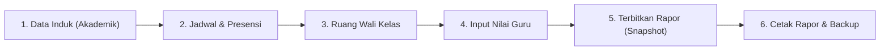

# Panduan Pengguna Sekolah Pilot — School Suite

Selamat datang di sistem manajemen sekolah terpadu **School Suite**. Dokumen ini memandu kepala sekolah, operator, guru, wali kelas, dan staf administrasi sekolah percontohan dalam mengoperasikan fitur-fitur utama sistem.

---

## 1. Akses Masuk & Kredensial Uji Coba

Gunakan kredensial bawaan berikut untuk mencoba peran yang berbeda pada lingkungan percontohan (pilot):

| Peran | Email Masuk | Kata Sandi | Deskripsi Akses |
|---|---|---|---|
| **Administrator** | `admin@pilot.sch.id` | `password` | Kendali penuh sistem, pengguna, profil sekolah, dan backup |
| **Kepala Sekolah** | `kepsek@pilot.sch.id` | `password` | Monitoring sekolah, pengesahan rapor, dan rekapitulasi |
| **Operator Sekolah**| `operator@pilot.sch.id` | `password` | Manajemen rombel, data induk siswa/guru, dan skema nilai |
| **Wali Kelas VII-A**| `budi@pilot.sch.id` | `password` | Ruang kerja wali kelas, generate rapor, ledger nilai kelas |
| **Guru Bahasa Ind.**| `siti@pilot.sch.id` | `password` | Input nilai mata pelajaran, presensi harian, jurnal kelas |
| **Siswa (Ahmad F.)**| `siswa26001@pilot.sch.id` | `password` | Akses rapor pribadi dan jadwal pelajaran |

Semua akun pilot dengan kata sandi awal di atas diwajibkan menggantinya saat pertama kali masuk.

---

## 2. Alur Kerja Operasional Utama



### 2.1 Manajemen Data Akademik (Operator & Admin)
- **Menu Data Siswa:** Kelola identitas peserta didik, NIS, NISN, dan status keaktifan.
- **Menu Data Guru:** Kelola data pengajar dan penugasan mata pelajaran.
- **Menu Rombel / Kelas:** Pembagian rombongan belajar per tingkat beserta wali kelas pendamping.
- **Impor Massal:** Unggah berkas CSV untuk mendaftarkan siswa secara massal dengan validasi duplikasi otomatis.

### 2.2 Operasi Harian: Presensi & Jurnal Mengajar (Guru)
- **Presensi Cepat:** Masuk ke menu `Presensi Siswa`. Pilih rombel dan tanggal hari ini. Gunakan tombol **"Hadirkan Semua"** untuk efisiensi waktu, lalu ubah status siswa yang sakit (S), izin (I), atau tanpa keterangan (A).
- **Jurnal Mengajar:** Catat topik materi pembelajaran yang diajarkan, tujuan pembelajaran, dan catatan evaluasi kelas.

### 2.3 Ruang Kerja Wali Kelas (Wali Kelas)
- **Dashboard Perwalian:** Memantau siswa yang membutuhkan perhatian khusus (*Early Warning Alert*) jika siswa memiliki absensi Alpa $\ge 3$ hari atau tingkat kehadiran $< 85\%$.
- **Catatan Observasi:** Rekam catatan perkembangan akademik, pembinaan sikap, atau konseling BK dengan kontrol privasi tingkat server (`Publik`, `Internal Guru`, atau `Rahasia BK`).
- **Dispensasi & Izin:** Catat surat dokter, dispensasi lomba dinas, dan permohonan izin keluarga.

### 2.4 Input Nilai Guru & Formula Remedial (Guru Mata Pelajaran)
- Masuk ke menu `Input Nilai`.
- Pilih Rombel dan Komponen Penilaian (misal: *Formatif 1*).
- Masukkan nilai mentah hasil ujian siswa (0–100).
- Jika ada siswa di bawah KKTP (75) yang mengikuti remedial, masukkan nilai remedial pada kolom remedial. Sistem akan menghitung nilai akhir secara otomatis:
  $$\text{Nilai Akhir} = \min(\text{Remedial}, \text{KKTP})$$
- Klik **"Simpan Semua Nilai"**.

### 2.5 Penerbitan Rapor & Buku Ledger (Wali Kelas & Kepala Sekolah)
- Buka menu `Rapor Siswa`.
- Pilih kelas yang diampu, lalu klik tombol **"Generate Rapor Kelas"** untuk menyusun draf snapshot nilai, presensi, dan catatan wali kelas.
- Tinjau kelengkapan nilai melalui menu **"Buku Ledger Nilai"**.
- Setelah nilai terkonfirmasi tuntas, klik **"Terbitkan & Kunci"**.
- Rapor yang telah terbit terkunci secara permanen dan memiliki stempel keaslian digital hash SHA-256 (`SS-D-005`). Perubahan nilai transaksional di kemudian hari tidak akan memengaruhi rapor yang telah terbit.

### 2.6 Cetak Rapor Siswa
- Klik tombol **"Cetak / Lihat"** pada siswa terpilih.
- Layout cetak baku rapor nasional akan terbuka. Tekan tombol **"Cetak Rapor (Print / PDF)"** untuk mencetak langsung ke kertas A4 atau menyimpannya sebagai file PDF.

---

## 3. Pemeliharaan & Cadangan Mandiri (Administrator)

Untuk memastikan keamanan data sebelum libur semester atau pembaruan sistem:
- Jalankan backup terminal server:
  ```bash
  php artisan school:backup
  ```
- File arsip ZIP terstempel waktu akan disimpan di `storage/app/backups/`.
- Periksa kesehatan sistem setiap saat melalui browser di URL:
  `http://localhost:8000/up` (harus menampilkan status `"healthy"`).

